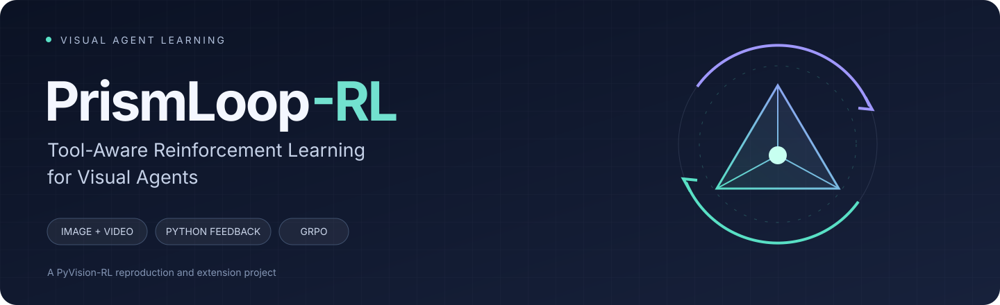
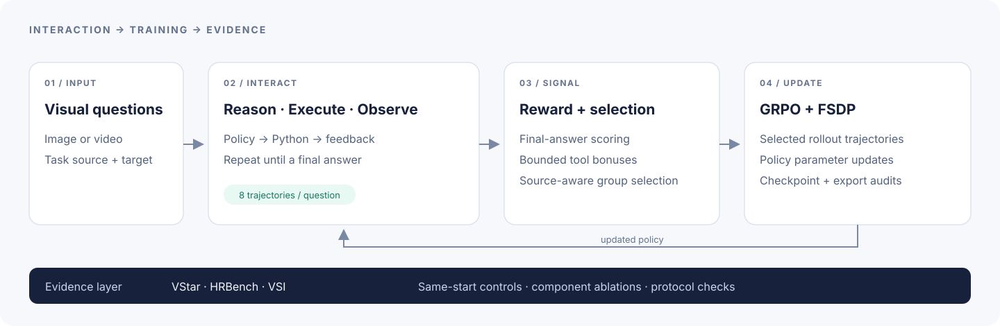
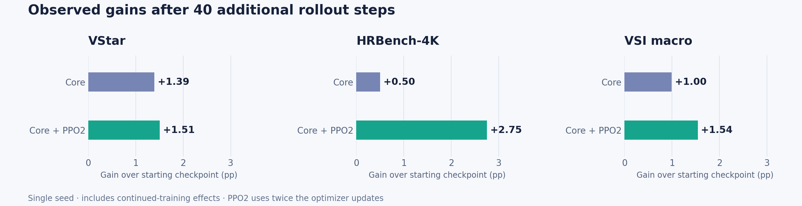

<div align="center">



# PrismLoop-RL

**Tool-Aware Reinforcement Learning for Visual Agents**

Train image and video agents through a loop of reasoning, Python execution, and visual feedback.

[](docs/REPRODUCTION.md)
[](docs/METHOD.md)
[](docs/METHOD.md)
[](LICENSE)

[中文介绍](README.zh-CN.md) · [Method](docs/METHOD.md) · [Experiments](docs/EXPERIMENTS.md) · [Reproduction](docs/REPRODUCTION.md) · [Roadmap](docs/ROADMAP.md)

</div>

## From seeing to acting

A visual agent can crop an image, inspect video frames, calculate a quantity, and use the result to decide what to do next. Training that behavior requires more than an answer score: rewards must read the intended answer, selection must account for task mixtures, and tool execution must remain reliable.

**PrismLoop-RL** is a personal research project that reproduces and extends [PyVision-RL](https://github.com/agents-x-project/PyVision-RL). It studies these training choices with explicit feature switches, short-run experiments, and auditable evaluations. The name pairs **Prism**, for visual inputs, with **Loop**, for interaction and policy improvement.



## Project highlights

- **End-to-end multimodal RL:** image/video preparation, interactive Python rollouts, FSDP training, validated checkpoint exports, and benchmark evaluation.
- **Three implemented training extensions:** final-answer reward parsing, source-aware rollout selection, and bounded tool bonuses, each connected to its source implementation below.
- **Six published extension evaluations:** core/PPO2 runs on VStar, HRBench-4K, and VSI; reproducible plotting from the aggregate score CSV.
- **Evidence before claims:** audits verify actual parameter updates and full-record evaluation coverage; explicit feature switches support original-method controls and component ablations.

## What is implemented

| Component | Design | Implementation |
|---|---|---|
| Final-answer rewards | Parse the final numeric answer before applying the existing MRA metric | [Answer extraction](verl_agents/verl/utils/reward_score/research_answer.py) |
| Source-aware selection | Allocate source quotas and rank surviving question groups within each source | [Rollout selection](verl_agents/verl/trainer/ppo/research_selection.py) |
| Tool-quality rewards | Credit successful, nonempty, distinct code/output pairs; cap repeated bonuses | [Tool reward](verl_agents/verl/workers/agent/envs/agents_x/research_tool_quality.py) |
| Reliable interaction | Spawn tool workers and bound cleanup of stalled workers | [Worker cleanup](verl_agents/verl/workers/agent/envs/agents_x/research_worker_cleanup.py) |
| Controlled experiments | Switch components independently; separate PPO epochs=1 and epochs=2 | [Training launcher](reproduction/scripts/run_training.py) |
| Evidence checks | Audit parameter updates, exported weights, evaluation records, and protocol consistency | [Update audit](reproduction/scripts/validate_research_update.py) · [Evaluation audit](reproduction/scripts/evaluation_evidence.py) |

These are extensions to the upstream training stack. The current evidence supports a reproducibility and experimental project; it does not establish a new state-of-the-art algorithm.

## Experimental snapshot

**40 additional rollout steps per experiment.** Image: step 20 → 60. Video: step 120 → 160. Scores are percentages under our server protocol with a local Qwen2.5-VL-32B judge. VStar uses avg@32; VSI uses the released eight-task macro average.

| Model / experiment | VStar ↑ | HRBench-4K ↑ | VSI macro ↑ |
|---|---:|---:|---:|
| Official SFT weights | 68.80 | 63.38 | 35.71 |
| Official released RL weights | 83.97 | 72.38 | 43.18 |
| Starting checkpoint, server reproduction | 70.14 | 66.00 | 35.98 |
| Core extensions, +40 steps | 71.53 | 66.50 | 36.98 |
| Core + PPO epochs=2, +40 steps | **71.65** | **68.75** | **37.52** |

Bold marks the best extension run in this snapshot, not the best score across all models. The image and video columns correspond to separate models.



**How to read the results.** Gains over the starting checkpoints include additional training. Same-budget original-algorithm controls and component ablations were pending in this snapshot. PPO epochs=2 performs twice as many optimizer updates per rollout batch. These single-seed runs do not establish statistical significance. Official released RL weights are references with unmatched training budgets.

[Full score table](results/benchmark-results.csv) · [Evaluation protocol and limitations](docs/EXPERIMENTS.md)

## Expected results at 700 steps — forecast, not measured

The following values are **subjective planning estimates**, conditional on continuing each modality to **total global step 700** under the same server evaluation protocol. They are not completed experiments, fitted learning-curve predictions, or statistical confidence intervals.

| Benchmark | Original algorithm, 700 steps: estimated center | PrismLoop core + PPO2, 700 steps: estimated center | PrismLoop subjective plausible range |
|---|---:|---:|---:|
| VStar avg@32 | 81% | 82% | 77–86% |
| HRBench-4K | 71% | 73% | 69–76% |
| VSI eight-task macro | 41% | 43% | 39–46% |

These estimates use the existing short-run scores and official released-weight references as qualitative anchors, assuming stable training and diminishing gains. They are not obtained by linear extrapolation, and improvement over the original algorithm is not guaranteed. Matching global steps does not match compute: PPO2 uses two optimizer updates per rollout batch. The estimates include only implemented core extensions and PPO epochs=2, excluding proposed research mechanisms. The original-algorithm estimates have no calibrated uncertainty range. No additional 700-step training is launched by publishing this table.

[Forecast assumptions and limitations](docs/EXPERIMENTS.md#700-step-planning-forecast) · [Separate forecast CSV](results/700-step-forecasts.csv)

## Explore the project

```text
PrismLoop-RL/
├── verl_agents/          # Upstream framework + current training extensions
├── reproduction/scripts/ # Data preparation, training, evaluation, audits
├── configs/              # Upstream configuration assets
├── results/              # Aggregate measured benchmark scores
├── assets/               # Project identity, pipeline, result visualization
├── docs/                 # Method, experiments, reproduction, provenance
└── scripts/              # Rebuild presentation assets
```

Start with [the method](docs/METHOD.md) to understand the changes, then follow [the reproduction guide](docs/REPRODUCTION.md). The validated stack uses Python 3.10, PyTorch 2.7, Transformers 4.54, vLLM 0.9.1, Ray 2.47, and FSDP.

**Release status:** research source snapshot. Historical launchers require machine-specific path and GPU configuration. Model weights and datasets are obtained separately. The evaluation framework is an external dependency. See the reproduction guide before launching jobs.

## Next experiments

- Complete original-algorithm controls from identical starting checkpoints and the component factorial design.
- Compare rollout steps, optimizer updates, generated tokens, and GPU time.
- Extend promising configurations to longer training and multiple seeds.
- Investigate spatial consistency, tool-repair credit, and adaptive rollout allocation as future directions.

The last three research mechanisms are proposals, not implemented capabilities. [Detailed roadmap →](docs/ROADMAP.md)

## Built on open research

PrismLoop-RL builds on **[PyVision-RL](https://github.com/agents-x-project/PyVision-RL)** and its bundled verl/RAGEN-derived training components. Original licenses and source notices are preserved. The original project documentation is available in [UPSTREAM_README.md](docs/UPSTREAM_README.md); exact revisions and snapshot hashes are recorded in [source-provenance.json](docs/source-provenance.json).

[PyVision-RL-Eval](https://github.com/agents-x-project/PyVision-RL-Eval) is referenced as an external dependency and is not redistributed here. See [third-party notices](THIRD_PARTY_NOTICES.txt). Please credit and cite the upstream work when using this project.

Maintained by [carlyer](https://github.com/carlyer) · [MIT license](LICENSE)
